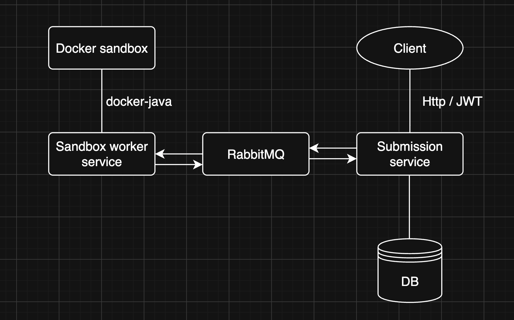

Backend for a mini code judge built with Spring Boot, for a uni project.

WIP

currently in a state of testing how docker-java works

Planned stack: Spring Boot 4, Java 21, Spring Security, PostgreSQL, Flyway, Spring AMQP, docker-java (to start the docker containers from java), JUnit and TestContainers

Planned architecture:

Rough scope and plan:
I want to develop it using microservices architecture and RabbitMQ message broker. The app is going to be split between two microservices (which will communicate through the broker both ways):
- Submission service which will be responsible for taking users code for "a programming task" and publishing the code with the test cases (inputs and expected outputs) inside a single message to RabbitMQ (say `judge.requests` queue). This service will also have JWT auth for the users, a single Postgres database (the only db in this project in fact) and a consumer for messages with test results coming back from the second service.
- Sandbox worker service which will have just functionality to consume a message from a queue (say `judge.requests`) and then start a sandboxed docker container with the user's code and run it against each test from the message, inside the container (it will compile java). Next after all tests have run (or as soon as one fails), this service will publish a message to the RabbitMQ (say `judge.results` queue) containing test results.

design decisions:
- No api gateway, since only the submission service will have endpoints
- Java will be the only supported language for now

Known limitations:
- class name of submitted code must be Main (this can be fixed tho with regex searching the file for class name)